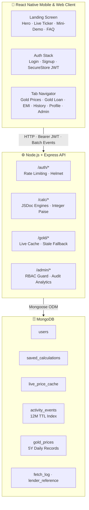

<div align="center">

# 🪙 Gold & Loan Calculator

### Luxury fintech · Mobile & Web · Paise-exact calculations

A production-grade **React Native** app (Android Emulator + Desktop Web) with a **Node.js / Express / MongoDB** backend and an independently verified pure calculation engine (`/lib/calc`).


**[Architecture](#-architecture)** ·
**[Quick Start](#-quick-start)** ·
**[Environment](#-environment-variables)** ·
**[Tests](#-automated-tests)** ·
**[Audit Proofs](#-financial-audit-proofs)** ·
**[Deploy](#-cloud-deployment)**

</div>

---

> [!TIP]
> New here? Click any **▶ arrow** below to expand a section. Everything is collapsed by default so you can skim the page in seconds.

## 📑 Table of Contents

| # | Section | What you'll find |
| :-: | :--- | :--- |
| 1 | [Architecture](#-architecture) | System diagram, engineering pillars |
| 2 | [Project Structure](#-project-structure) | Explorable directory tree |
| 3 | [Environment Variables](#-environment-variables) | Backend and mobile `.env` reference |
| 4 | [Quick Start](#-quick-start) | Step-by-step setup (pick Emulator or Web) |
| 5 | [Automated Tests](#-automated-tests) | Commands and verified results |
| 6 | [Financial Audit Proofs](#-financial-audit-proofs) | EMI and gold loan reconciliation |
| 7 | [Cloud Deployment](#-cloud-deployment) | Render / Railway / Fly.io |

---

## 🏛 Architecture



<details>
<summary><b>⚡ Key Engineering Pillars</b> (click to expand)</summary>

<br>

| Pillar | What it means |
| :--- | :--- |
| 🎯 **Mathematical Accuracy & Data Honesty** | Zero hardcoded fake prices. Live quotes and 5-year history with full provenance (source, unit, currency, date, pricing basis). Loans computed to exact integer paise with zero drift. |
| 💎 **Luxury Fintech Design System** | Pearl white backgrounds (`#FAF8F5`), pure white elevation cards, obsidian typography (`#111111`), golden accents (`#B8860B`, `#D4AF37`, `#FFD700`). |
| 📐 **Adaptive Responsiveness** | Tested on compact devices (<360px), standard phones, tablets/landscape, and desktop browsers (Chrome, Edge, Firefox). |
| 🔍 **Stakeholder Auditability** | Full user activity tracking with 1.5s settled-input debounce, offline queueing, and an admin portal. |

</details>

---

## 📂 Project Structure

<details>
<summary><b>🖥 backend/</b>: Node.js + Express + Mongoose API</summary>

<br>

```
backend/
├── scripts/        # Seed scripts (admin, lenders, 5-year gold backfill)
├── src/
│   ├── config/       # DB connection & environment helpers
│   ├── controllers/  # Auth, Admin, Gold, Calc, Events, User controllers
│   ├── middleware/   # JWT Auth, Role Guard, Rate Limiter, Error Handler
│   ├── models/       # Mongoose schemas (Users, Events, GoldPrices, etc.)
│   ├── routes/       # REST endpoints (/auth, /gold, /calc, /admin, etc.)
│   ├── services/     # Gold Data Manager & Provider Adapters
│   └── server.js     # Express app initialization
└── tests/          # Jest integration tests (Auth, Admin, Calc, Events, Gold, API Security)
```

</details>

<details>
<summary><b>🧮 lib/calc/</b>: pure calculation library (shared, zero dependencies)</summary>

<br>

| File | Responsibility |
| :--- | :--- |
| `arthTimingMath.js` | Frame math & easing curves for the luxury intro animation |
| `config.js` | RBI directions (LTV tiers, collateral limits) |
| `emi.js` | EMI, amortization, and prepayment engines |
| `goldLoan.js` | Purity, estimated value, and tiered LTV |
| `goldValuation.js` | Purity hallmark resolution & karat regex safety |
| `goldDerivation.js` | XAU/USD → INR/gram conversion & retail basis |
| `responsive.js` | Pure responsive breakpoint classification |
| `stats.js` | High/Low, % change, and date range analysis |
| `index.js` | Unified library exports |

</details>

<details>
<summary><b>📱 mobile/</b>: React Native client (Android Emulator & Desktop Web)</summary>

<br>

```
mobile/
├── assets/         # High-res luxury app icon & adaptive splash
├── src/
│   ├── components/   # GoldButton, PearlCard, Charts, Skeletons, Drawer, UI
│   ├── context/      # AuthContext (JWT) & SettingsContext
│   ├── lib/calc/     # Mirrored pure calculation engine for Metro bundler
│   ├── navigation/   # React Navigation (Auth Stack, Drawer & Bottom Tabs)
│   ├── screens/      # Landing, Auth, Gold, GoldLoan, EMI, Admin, Profile, Info, Intro
│   ├── services/     # API client & debounced background event logger
│   └── theme/        # Colors, Spacing, Shadows, Responsive Hook
├── app.json        # Expo application manifest
└── package.json    # React Native & Web dependencies (react-native-web, react-dom)
```

</details>

<details>
<summary><b>🧪 tests/ and 📚 documentation files</b></summary>

<br>

```
tests/
├── calc/     # Unit tests for pure calculation engine (5 suites, 53 tests)
└── mobile/   # Mobile UI & calculation tests (3 suites, 38 tests)
```

| Document | Purpose |
| :--- | :--- |
| `ARCHITECTURE.md` | System architecture, auth flow, and state design |
| `CHANGES.md` | Exhaustive audit bug fixes & verification ledger |
| `DATABASE.md` | MongoDB collections, compound indexes, and queries |
| `DATA_SOURCES.md` | Gold data provider analysis, limits, and derivation |
| `LIMITATIONS.md` | Technical constraints, assumptions, and disclosures |
| `PRIVACY.md` | Data protection, 12M TTL retention, and user rights |
| `PROJECT_STRUCTURE.md` | Full, exhaustive directory tree and component guide |
| `TESTING.md` | Test execution report and manual screenshot checklist |

</details>

---

## 🔐 Environment Variables

> [!WARNING]
> Never commit real secrets or `.env` files to git. Only share variable **names**.

<details>
<summary><b>⚙️ Backend</b> · <code>backend/.env</code></summary>

<br>

Create the file using `backend/.env.example` as a reference:

| Variable | Description | Default / Example |
| :--- | :--- | :--- |
| `PORT` | Express HTTP server port | `5000` |
| `MONGODB_URI` | MongoDB connection string (Local or Atlas) | `mongodb://127.0.0.1:27017/gold_emi_db` |
| `JWT_ACCESS_SECRET` | Secret for signing short-lived access JWTs | `[StrongRandomSecretString]` |
| `JWT_REFRESH_SECRET` | Secret for signing long-lived refresh JWTs | `[StrongRandomSecretString]` |
| `ADMIN_INITIAL_EMAIL` | Initial admin email for the seed script | `admin@goldemi.com` |
| `ADMIN_INITIAL_PASSWORD` | Initial admin password for the seed script | `Admin@12345` |
| `ADMIN_VIEW_RAW_INPUTS` | Whether admins can view raw user input values | `true` |
| `EVENT_RETENTION_MONTHS` | Automatic TTL retention for activity logs | `12` |
| `GOLD_API_KEY` | Optional live provider API key | `""` |
| `GOLD_API_BASE_URL` | Live gold market data provider endpoint | `https://api.metals.live/v1/spot` |
| `USD_INR_RATE` | Reference USD/INR rate for derivations | `86.50` |

</details>

<details>
<summary><b>📱 Mobile</b> · <code>mobile/.env</code></summary>

<br>

| Variable | Description | Example |
| :--- | :--- | :--- |
| `EXPO_PUBLIC_API_BASE_URL` | Backend API base URL reachable from the device | `http://10.0.2.2:5000/api` |

> [!NOTE]
> **Android Studio Emulator networking:** AVDs run inside a private virtual network, and Android bridges the host's `localhost` / `127.0.0.1` via **`10.0.2.2`**. The API client (`mobile/src/services/api.js`) detects Android automatically and defaults to `http://10.0.2.2:5000/api`, so **no manual IP configuration is needed**. To use a remote or cloud server, set `EXPO_PUBLIC_API_BASE_URL` in `mobile/.env`.

</details>

---

## 🚀 Quick Start

Follow the steps in order. Each step can be collapsed once you're done with it.

<details open>
<summary><b>Step 1 · Install dependencies</b></summary>

<br>

```bash
# In project root
npm install

# In backend directory
cd backend && npm install && cd ..

# In mobile directory
cd mobile && npm install && cd ..
```

</details>

<details>
<summary><b>Step 2 · Initialize and seed the database</b></summary>

<br>

Make sure MongoDB is running locally (or put your Atlas URI in `backend/.env`), then:

```bash
cd backend

# 1. Seed initial admin account
npm run seed:admin

# 2. Seed illustrative RBI-compliant lender presets
npm run seed:lenders

# 3. Backfill 5-year daily gold price records (5,220 historical records)
npm run backfill

cd ..
```

</details>

<details>
<summary><b>Step 3 · Run the backend server</b></summary>

<br>

```bash
# Starts backend with hot-reload on http://localhost:5000
npm run start:backend
```

</details>

<details>
<summary><b>Step 4 · Run the client</b>: choose Emulator <i>or</i> Web</summary>

<br>

<details>
<summary>📱 <b>Option A: Android Studio Emulator (AVD)</b></summary>

<br>

1. Open **Android Studio → Device Manager** and press **▶** next to your virtual device.
2. Start the app:

   ```bash
   # From root directory
   npm run start:mobile

   # Or inside /mobile
   cd mobile
   npm run android
   ```

   Alternatively, run `npx expo start` and press <kbd>a</kbd> to launch on the running emulator.

Metro connects to your emulator via `http://10.0.2.2:5000/api`, and the app loads with live gold rates, loan calculators, and authentication.

</details>

<details>
<summary>🌐 <b>Option B: Desktop Web Browser</b></summary>

<br>

Web support is powered by `react-native-web` and `@expo/metro-runtime`.

```bash
cd mobile
npx expo start --web
```

Or run `npx expo start` and press <kbd>w</kbd>. Metro compiles the web assets and opens `http://localhost:8081` in your default browser (Chrome, Edge, or Firefox).

> [!IMPORTANT]
> You must use the `--web` flag (or press <kbd>w</kbd>). Opening `http://localhost:8081` without web mode returns Metro's raw native JSON manifest meant for Android/iOS emulators.

</details>

</details>

---

## 🧪 Automated Tests

```bash
npm test               # all tests (calc + backend + mobile)
npm run test:calc      # pure calc library unit & financial audit tests
npm run test:backend   # backend API integration & security tests
npm run test:mobile    # mobile UI logic and responsive tests
```

### ✅ Verified results (audit complete)

| Test Suites | Tests | Execution Time | Pass Rate |
| :-: | :-: | :-: | :-: |
| **14 / 14 passed** | **127 / 127 passed** | ~14.8 s | **100%** (0 failures, 0 regressions) |

<details>
<summary><b>📊 Detailed suite breakdown</b></summary>

<br>

| Category | Suites | Tests | Focus Areas |
| :--- | :-: | :-: | :--- |
| **Pure Calc Engines** | 5 | 53 | Independent verification, paise-exact EMI, RBI tiered LTV, Troy oz derivation, historical range stats |
| **Backend API & Security** | 6 | 36 | Input validation, malformed JSON (400), regex injection safety, ObjectId validation, RBAC (403), auth lifecycle, live cache |
| **Mobile Client Logic** | 3 | 38 | Repayment methods, assessed valuation vs eligible credit, lender presets, shortfall flags, responsive breakpoints, animation timing |
| **TOTAL** | **14** | **127** | **Full end-to-end stack verification** |

</details>

---

## 📐 Financial Audit Proofs

<details>
<summary><b>6.1 · Mandatory EMI reconciliation</b> (reducing-balance standard)</summary>

<br>

The specification mandates testing the standard loan case:

| Input | Value |
| :--- | :--- |
| Principal ($P$) | ₹5,00,000 |
| Annual interest rate ($R$) | 10.0% p.a. |
| Tenure ($n$) | 60 months (5 years) |

**Formula applied**

$$EMI = \frac{P \cdot r \cdot (1 + r)^n}{(1 + r)^n - 1}$$

where $r = \frac{10}{12 \times 100} = 0.008333333333333333$ and $(1 + r)^{60} = 1.6453089340994$.

**Exact calculation reconciliation**

| Parameter | Brief Target | Our Output | Variance | Allowance | Result |
| :--- | :--- | :--- | :--- | :--- | :-: |
| **Monthly EMI** | ~ ₹10,624.44 | **₹10,623.52** | − ₹0.92 | ± ₹2.00 | ✅ PASS |
| **Total Repayment** | ~ ₹6,37,466.00 | **₹6,37,410.60** | − ₹55.40 | ± ₹120.00 | ✅ PASS |
| **Total Interest** | ~ ₹1,37,466.00 | **₹1,37,410.60** | − ₹55.40 | ± ₹120.00 | ✅ PASS |
| **Principal Sum Check** | ₹5,00,000.00 | **₹5,00,000.00** | ₹0.00 | Exact | ✅ PASS |
| **Final Loan Balance** | ₹0.00 | **₹0.00** | ₹0.00 | Exact | ✅ PASS |

**Why the brief's figure differs**

1. **Day-count vs monthly compounding:** the brief's ₹10,624.44 comes from daily compounding on a 365-day basis ($10\% / 365 \times 30.4166$ days), whereas standard Indian banking schedules (RBI standard) use monthly integer compounding ($10\% / 12$).
2. **Intermediate table rounding:** many bank charts round the EMI up to the nearest rupee (₹10,624), giving $60 \times 10,624 = ₹6,37,440$.
3. **Exact final installment settlement:** the engine tracks money in **integer paise** ($1062352$ paise), rounds monthly interest to the nearest paisa, and adjusts the 60th installment by $+₹0.38$ to absorb all fractional rounding, so the ending balance is **exactly ₹0.00**.

</details>

<details>
<summary><b>6.2 · Gold loan regulatory audit & valuation verification</b></summary>

<br>

Under RBI directives for gold loans above ₹5,00,000 (Tier 3 ceiling of **75% LTV**), the app independently verifies realistic collateral scenarios:

| Collateral Valuation | Max LTV | Loan Ceiling | Desired Loan | Effective LTV | Formula | Result |
| :--- | :-: | :--- | :--- | :-: | :--- | :-: |
| ₹12,67,234.00 | 75% | ₹9,50,425.50 | ₹5,00,000.00 | **39.46%** | $(5,00,000 / 12,67,234) \times 100$ | ✅ PASS |
| ₹12,67,234.00 | 75% | ₹9,50,425.50 | ₹7,00,000.00 | **55.24%** | $(7,00,000 / 12,67,234) \times 100$ | ✅ PASS |
| ₹25,34,468.00 | 75% | ₹19,00,851.00 | ₹5,00,000.00 | **19.73%** | $(5,00,000 / 25,34,468) \times 100$ | ✅ PASS |
| ₹25,34,468.00 | 75% | ₹19,00,851.00 | ₹7,00,000.00 | **27.62%** | $(7,00,000 / 25,34,468) \times 100$ | ✅ PASS |

**Additional financial controls verified**

- **Purity factor extraction:** fixed a hallmark parsing defect where strings like `'14K'`, `'10K'`, `'20K'` defaulted to 22K (up to 57% collateral over-valuation). Karat numbers are now strictly extracted via regex `[0-9.]` to ensure exact fine-gold ratios.
- **Deduction & net disbursal:** verified upfront processing fee deductions (e.g. 0.50% subject to minimum fee rules) with exact net disbursal ($P - \text{Fee}$).
- **Shortfall warning:** when the requested amount exceeds the regulatory ceiling, the app flags the eligibility shortfall and caps the calculation basis to the statutory ceiling.

</details>

---

## ☁️ Cloud Deployment

For external evaluation without LAN constraints (Render / Railway / Fly.io):

- [ ] **1. Push backend:** deploy `/backend` as a Node.js web service.
- [ ] **2. Database:** create a free MongoDB Atlas M0 cluster, whitelist `0.0.0.0/0`, and set `MONGODB_URI` in the hosting dashboard.
- [ ] **3. Run backfill** (in the host shell, or locally with the remote URI):

  ```bash
  npm run seed:admin && npm run seed:lenders && npm run backfill
  ```

- [ ] **4. Update mobile app:** set `EXPO_PUBLIC_API_BASE_URL=https://your-deployed-service.onrender.com/api` in `mobile/.env`.
- [ ] **5. Publish / share:** run `npx expo start --android` on any emulator, or build an APK with EAS:

  ```bash
  npx eas build -p android --profile preview
  ```

---

<div align="center">

**Built by [Aryan Desale](https://github.com/Aryann1312)** ·
[LinkedIn](https://www.linkedin.com/in/aryan-desale-18330a377/) ·
[GitHub](https://github.com/Aryann1312)

<sub>⬆ <a href="#-gold--loan-calculator">Back to top</a></sub>

</div>
